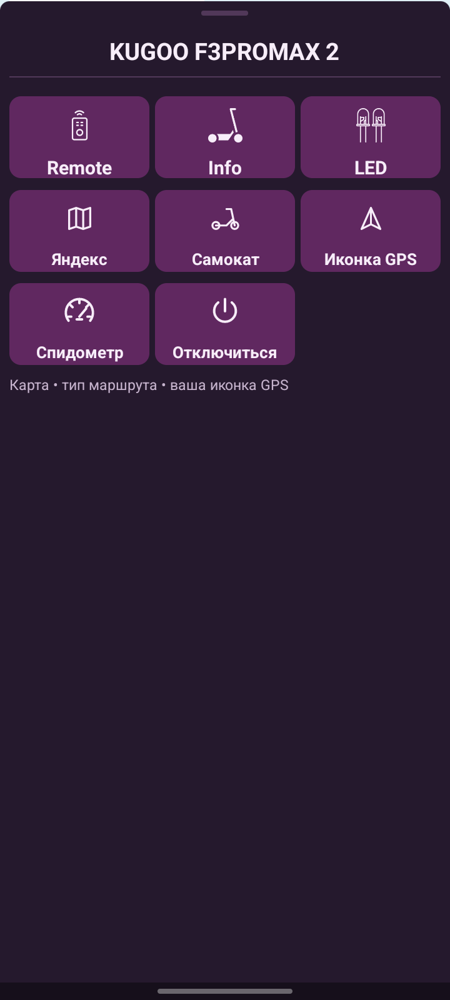
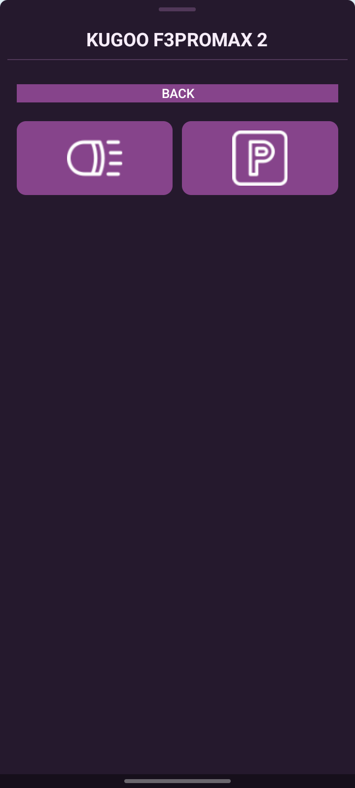

# SC-Android

Android-приложение для подключения к самокату, просмотра телеметрии, управления фонарём и парковкой, работы с картами и внешней LED-подсветкой. Поддерживает Midway i Pro и экспериментальное подключение Kugoo F3 Pro Max.

[Скачать APK](https://github.com/denis-hik/SC-Android/releases/latest) · [Релиз 1.0.5](https://github.com/denis-hik/SC-Android/releases/tag/v1.0.5)

Требуется Android 6.0 или новее и Bluetooth LE. Доступность команд и данных зависит от модели и прошивки самоката.

## Интерфейс

| Главное меню | Управление Kugoo |
| :---: | :---: |
|  |  |

## Возможности

- **Телеметрия:** скорость, заряд, напряжение и другие доступные параметры самоката.
- **Управление:** фонарь и парковка Kugoo; выбор режима езды для Midway. Набор кнопок зависит от подключённого самоката.
- **Подключение Kugoo:** сохранённые профили, выбор основного самоката и восстановление связи после разрыва установленного соединения.
- **Спидометр:** шкала 0–100, скорость, передача, напряжение и дуга заряда. Запись экрана с разрешением Android и режимом зелёного фона для монтажа видео.
- **Карты:** Яндекс, 2ГИС или полное скрытие карты. Сохранённые места, поиск временного маршрута, выбор типа передвижения для Яндекса и своя GPS-иконка.
- **LED:** передача скорости по WebSocket/GyverHub или Bluetooth, сохранение BLE-устройств и автоматическое восстановление подключений.
- **Перенос профилей:** импорт из файла, экспорт и отправка файла через системное меню «Поделиться».

## Подключение

### Midway

Включите самокат и Bluetooth, предоставьте запрошенные разрешения и выберите самокат в поиске Midway. Для поиска и карт приложение запрашивает доступ к геопозиции; на новых версиях Android также нужны разрешения на устройства поблизости.

### Kugoo F3 Pro Max

Сначала привяжите свой самокат в официальном Kugoo Riding. В SC откройте раздел Kugoo и получите профиль одним из способов:

1. **Авторизация и получение:** установите и запустите официальное приложение Kugoo, затем введите регион, почту и пароль своего аккаунта в окне SC. После получения данных выберите самокат.
2. **Импорт через root:** отдельный способ чтения профиля из локального хранилища официального приложения. Требует root-доступа; результат зависит от версии приложения, Android и ограничений KeyStore/SELinux.
3. **Импорт из файла:** выберите файл подключения, ранее экспортированный из SC на другом телефоне.

Затем освободите Bluetooth-соединение самоката в официальном приложении или на другом телефоне и подключитесь через SC. Для последующих подключений используется сохранённый профиль — повторный импорт обычно не нужен.

Профили на устройстве хранятся зашифрованно. **Файл переноса содержит данные доступа к самокату:** передавайте его только на свои устройства и не публикуйте в issues, репозитории или общих чатах.

Подключение и получение данных проверялись на Kugoo F3 Pro Max. Авторизация проверялась с Kugoo Riding 1.0.2; совместимость с другими версиями официального приложения и всеми самокатами серии F не гарантируется. Вход зависит от доступности облачного сервиса.

## LED-подсветка

### WebSocket / GyverHub

В разделе LED откройте настройки и укажите IP/имя контроллера, порт WebSocket и ID платы из её прошивки. Информация о протоколе доступна через кнопку информации в настройках.

Целевая скорость **30–150 км/ч** задаёт масштаб эффекта подсветки: при этой скорости выходной параметр достигает 255. Она не меняет ограничение скорости самоката. После неудачной первой попытки автоматическое повторение поиска запускается кнопкой обновления.

- Библиотека контроллера: [GyverHub](https://github.com/GyverLibs/GyverHub/).
- Связанный проект подсветки: [SC-Led-Ardruino](https://github.com/denis-hik/SC-Led-Ardruino).

### Bluetooth

Откройте поиск Bluetooth в разделе LED, выберите совместимый контроллер и добавьте другие устройства кнопкой «+». Сохранённые устройства используются для последующего автоматического подключения; крестик у устройства отключает и забывает его.

Реализован протокол контроллеров ELK/SmartLED, а не универсальная поддержка любой Bluetooth-подсветки. Число одновременных соединений с самокатом и LED зависит от телефона и контроллеров.

## Сборка

Используются JDK 11, Android SDK 33 и Gradle Wrapper из репозитория. Минимальная версия Android — API 23.

1. Откройте проект в Android Studio и установите Android SDK 33.
2. Настройте `sdk.dir` в локальном `local.properties`.
3. Для работы Thingclips SDK задайте собственные `tuya.appKey` и `tuya.appSecret`, соответствующие пакету приложения и сертификату подписи. Не добавляйте `local.properties` в Git.
4. Выполните сборку и тесты:

```powershell
.\gradlew.bat :app:assembleDebug :app:testDebugUnitTest
```

Для основной release-сборки:

```powershell
.\gradlew.bat -I scripts/sc-release.init.gradle :app:assembleRelease :app:testReleaseUnitTest
```


## Структура кода

Пакеты находятся в `app/src/main/java/sc/denishik/ru/`:

| Каталог | Назначение |
| --- | --- |
| `kuggoApi` | Авторизация, профили, BLE-подключение и команды Kugoo |
| `midwayApi` | Подключение и команды Midway |
| `ledApiBLU` | Bluetooth-подсветка |
| `ledApiWS` | WebSocket-подсветка |
| `mapsApi` | Карты, места и маршруты |
| `pages` | Основные экраны и спидометр |
| `tuya` | Экраны получения и импорта профилей |
| `other` | Общие компоненты и модальные окна |

SC — независимый проект. Наличие OTA-методов в SDK не означает наличия совместимой прошивки: проверенного файла обновления для F3 Pro Max в проекте нет.
